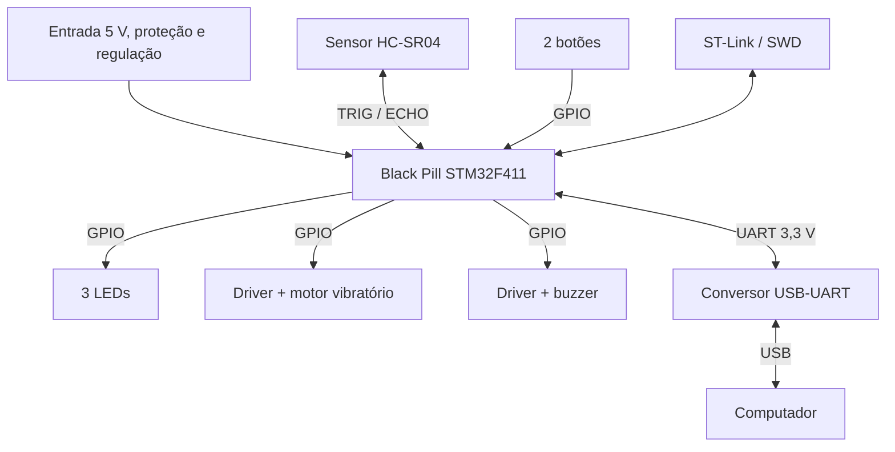

# Sistema Embarcado de Detecção de Obstáculos com Alertas Sonoros e Vibrotáteis

**Disciplina:** Sistemas Embarcados 1  
**Instituição:** Universidade Federal de Uberlândia (UFU) — FEELT  
**Responsável:** Pedro Emílio de Paula Paiva  
**Professor:** Daniel Pereira de Carvalho
**Data prevista de entrega:** 14/12/2026  
**Status:** Proposta e planejamento

---

## 1. Proposta inicial

### 1.1 Objetivo

Desenvolver um protótipo educacional de tecnologia assistiva baseado no microcontrolador STM32F411, capaz de detectar a proximidade de obstáculos utilizando o sensor ultrassônico HC-SR04 e informar o usuário por meio de LEDs, buzzer e motor vibratório.

O sistema também utilizará comunicação UART para transmitir as medições a um computador e receber comandos de configuração.

O projeto possui caráter educacional e demonstrativo, não sendo destinado ao uso como dispositivo de segurança certificado para orientação de pessoas com deficiência visual.

### 1.2 Integrante e responsabilidades

O projeto será desenvolvido individualmente por **Pedro Emílio de Paula Paiva**, responsável pelas três frentes principais:

| Frente | Responsabilidades |
|---|---|
| Hardware | Desenvolvimento do esquemático, dimensionamento dos componentes, layout da PCB no Altium Designer e geração dos arquivos de fabricação. |
| Firmware | Desenvolvimento dos drivers de GPIO, timer e UART, além da lógica principal da aplicação, utilizando acesso direto aos registradores. |
| Validação e documentação | Montagem experimental, realização dos testes, medições, depuração com GDB/OpenOCD, elaboração do relatório e atualização do repositório Git. |

Todas as etapas serão registradas por meio de commits, permitindo acompanhar a evolução do projeto.

### 1.3 Diagrama de blocos



### 1.4 Funcionamento planejado

O STM32 realizará a leitura do sensor HC-SR04 e calculará a distância entre o dispositivo e o obstáculo.

Conforme a distância medida, serão acionados diferentes tipos de alerta.

| Distância estimada | Indicação luminosa | Buzzer e motor vibratório |
|---|---|---|
| Acima de 50 cm | LED verde | Desligados |
| Acima de 20 cm até 50 cm | LED amarelo | Alertas intermitentes lentos |
| Até 20 cm | LED vermelho | Alertas intermitentes rápidos |

Os limites apresentados são valores iniciais para testes e poderão ser ajustados durante o desenvolvimento.

Leituras inválidas e perda de eco serão tratadas separadamente no firmware, evitando que sejam interpretadas como uma distância segura.

**Botões de controle:**

- **Botão 1:** ativar ou desativar o monitoramento.
- **Botão 2:** alternar entre os modos de alerta sonoro, vibratório ou ambos.

Será implementado debounce por software para evitar múltiplos acionamentos causados pelas oscilações mecânicas dos botões.

### 1.5 Lista preliminar de componentes

| Componente | Quantidade | Função |
|---|---|---|
| Black Pill STM32F411CEU6 | 1 | Microcontrolador principal |
| Sensor HC-SR04 | 1 | Medição de distância |
| Motor vibratório nominal 3 V | 1 | Alerta tátil |
| Buzzer ativo 5 V | 1 | Alerta sonoro |
| LEDs verde, amarelo e vermelho | 3 | Sinalização visual |
| Botões tácteis | 2 | Controle do usuário |
| Conversor USB-UART de 3,3 V | 1 | Comunicação com o computador |
| MOSFETs canal N | 2 | Acionamento do motor vibratório e buzzer |
| Resistores, capacitores e diodos | A dimensionar | Alimentação, proteção e polarização |
| Conectores | A dimensionar | Integração dos módulos |
| PCB de duas camadas | 1 projeto | Integração dos circuitos |

**Datasheets e referências técnicas:**

- [STM32F411CEU6 — STMicroelectronics](https://www.st.com/resource/en/datasheet/stm32f411ce.pdf)
- [HC-SR04 — Documentação técnica](https://www.mouser.com/datasheet/2/813/HCSR04-2307007.pdf)
- [CP2102N — Silicon Labs](https://www.silabs.com/documents/public/data-sheets/cp2102n-datasheet.pdf)
- [Motor vibratório 310-103 — Precision Microdrives](https://precisionmicrodrives.com/cdn/catalog_product/89437681-576e-46e1-97cf-5ae185adeb1c/310-103-datasheet.pdf)

**Observação:** os modelos definitivos dos componentes serão escolhidos durante o desenvolvimento do esquemático, considerando disponibilidade, características elétricas e custo. O datasheet do CP2102N é uma referência da família; será necessário verificar o circuito integrado presente no módulo USB-UART adquirido.

### 1.6 Microcontrolador escolhido

O microcontrolador escolhido será o **STM32F411CEU6**, pertencente à família STM32F4 e baseado no processador ARM Cortex-M4.

A escolha se justifica pela disponibilidade dos seguintes periféricos:

- **GPIO:** controle dos LEDs, motor vibratório, buzzer e leitura dos botões.
- **Timers:** medição precisa do tempo do pulso ECHO do HC-SR04.
- **USART:** comunicação UART com o computador.
- **SWD:** gravação e depuração do firmware.

O STM32F411CEU6 possui frequência máxima de operação de 100 MHz, 512 KB de memória Flash e 128 KB de SRAM, recursos suficientes para a aplicação.

Será utilizada uma placa de desenvolvimento **Black Pill**, permitindo validar o firmware sem a necessidade de soldar diretamente o microcontrolador em encapsulamento UFQFPN-48.

A PCB própria será desenvolvida no Altium Designer, utilizando conectores para encaixar a Black Pill e integrar os demais componentes.

**Pendente de aprovação:** confirmar com o professor se a Black Pill poderá permanecer como módulo na PCB própria.

### 1.7 Barramento obrigatório

Será utilizada comunicação **UART**, por meio da USART1 do STM32F411.

A interface permitirá a comunicação bidirecional entre o microcontrolador e um computador, utilizando um conversor USB-UART com níveis lógicos de 3,3 V.

**Configuração prevista:**

| Parâmetro | Valor |
|---|---|
| Periférico | USART1 |
| Pino TX | PA9 |
| Pino RX | PA10 |
| Taxa de transmissão | 115200 baud |
| Bits de dados | 8 |
| Paridade | Nenhuma |
| Bits de parada | 1 |
| Controle de fluxo | Nenhum |
| Níveis lógicos | 3,3 V |

O mapeamento será confirmado conforme a revisão da Black Pill utilizada.

A comunicação permitirá transmitir informações como:

```text
DIST=80;STATUS=SEGURO;MOTOR=0;BUZZER=0
DIST=40;STATUS=ATENCAO;MOTOR=1;BUZZER=1
DIST=15;STATUS=PERIGO;MOTOR=1;BUZZER=1
```

Também serão implementados comandos para configuração:

| Comando | Função |
|---|---|
| `STATUS` | Solicitar informações do sistema |
| `MOTOR=ON` | Habilitar alerta vibratório |
| `MOTOR=OFF` | Desabilitar alerta vibratório |
| `BUZZER=ON` | Habilitar alerta sonoro |
| `BUZZER=OFF` | Desabilitar alerta sonoro |
| `LIMITE=30` | Configurar o limite de proximidade |

Os comandos de habilitação não significam acionamento contínuo dos dispositivos; os alertas continuarão condicionados à lógica de proximidade.

A configuração da UART será realizada diretamente pelos registradores do STM32, sem utilização da biblioteca HAL.

### 1.8 Critérios de sucesso e validação

| Verificação | Critério de aceitação | Evidência |
|---|---|---|
| Alimentação | Tensões dentro das especificações dos componentes | Multímetro |
| Medição de distância | Meta inicial de erro absoluto de até 2 cm entre 10 e 100 cm, em condições controladas | Régua ou trena e tabela de resultados |
| Alertas visuais | LED correspondente à faixa de distância | Teste funcional |
| Motor vibratório | Vibração conforme a proximidade | Teste funcional e medição do acionamento |
| Buzzer | Bipes conforme a proximidade | Teste funcional |
| Botões | Uma mudança de estado por pressionamento | Teste de debounce |
| Integração GPIO e UART | Comando UART altera a configuração dos alertas | Terminal serial e teste funcional |
| Comunicação UART | Quadros 115200 8N1 corretamente transmitidos e recebidos | Analisador lógico ou osciloscópio |
| Depuração | Breakpoint, inspeção de variáveis e registradores | GDB/OpenOCD via SWD |
| Esquemático | ERC sem erros não justificados | Verificação no Altium |
| PCB | DRC sem erros | Verificação no Altium |

Os critérios representam metas de desenvolvimento e serão comparados com os resultados obtidos nos testes reais.

### 1.9 Cronograma

O projeto será desenvolvido individualmente, sendo todas as etapas de responsabilidade de Pedro Emílio de Paula Paiva.

| Período | Atividade | Status |
|---|---|---|
| 16 a 19/11 | Aprovação da proposta e seleção dos componentes | Em andamento |
| 19 a 25/11 | Desenvolvimento do esquemático no Altium e ERC | Pendente |
| 23 a 30/11 | Testes iniciais de GPIO e periféricos na Black Pill | Pendente |
| 26/11 a 03/12 | Layout da PCB, DRC, Gerbers e BOM | Pendente |
| 01 a 08/12 | Desenvolvimento dos drivers, timer, UART e integração | Pendente |
| 08 a 11/12 | Testes instrumentais e depuração GDB/OpenOCD | Pendente |
| 11 a 13/12 | Relatório, documentação e revisão dos arquivos | Pendente |
| 14/12 | Entrega final | Pendente |

As atividades de hardware e firmware poderão ocorrer parcialmente em paralelo.

### 1.10 Custo estimado

| Componente | Estimativa |
|---|---|
| Black Pill STM32F411 | R$ 40–65 |
| HC-SR04 | R$ 8–18 |
| Motor vibratório | R$ 10–25 |
| Buzzer ativo | R$ 3–10 |
| Conversor USB-UART | R$ 12–25 |
| LEDs, botões e resistores | R$ 8–18 |
| MOSFETs, diodos, capacitores e conectores | R$ 15–35 |
| **Total estimado** | **R$ 96–196** |

Os valores são estimativas preliminares, não cotações atualizadas. Não incluem frete, ferramentas ou fabricação da PCB.

### 1.11 Questões para aprovação do professor

- [ ] Utilização da Black Pill encaixada na PCB própria.
- [ ] Utilização da UART com computador como barramento obrigatório.
- [ ] Validação experimental em bancada sem necessidade de fabricar a PCB, mantendo os entregáveis completos de CAD.

---

## 2. Acompanhamento do desenvolvimento

Esta seção será atualizada conforme o andamento do projeto.

| Etapa | Status | Evidências |
|---|---|---|
| Elaboração da proposta | Concluída | README inicial |
| Aprovação do professor | Aguardando | Parecer a adicionar |
| Esquemático no Altium | Não iniciado | A adicionar |
| Verificação ERC | Não realizada | A adicionar |
| Layout da PCB | Não iniciado | A adicionar |
| Verificação DRC | Não realizada | A adicionar |
| Firmware GPIO | Não iniciado | A adicionar |
| Firmware timer e HC-SR04 | Não iniciado | A adicionar |
| Comunicação UART | Não iniciada | A adicionar |
| Integração dos alertas | Não iniciada | A adicionar |
| Capturas com instrumentos | Não realizadas | A adicionar |
| Depuração GDB/OpenOCD | Não realizada | A adicionar |
| Relatório final | Não iniciado | A adicionar |

### 2.1 Diário de desenvolvimento

#### 19/11/2026 — Proposta inicial

- Criação do repositório GitHub.
- Definição do objetivo e escopo do projeto.
- Escolha preliminar do STM32F411 Black Pill.
- Definição do sensor HC-SR04.
- Definição dos alertas luminosos, sonoros e vibratórios.
- Escolha da comunicação UART como barramento obrigatório.
- Elaboração do cronograma, critérios de sucesso e estimativa de custos.
- Preparação do README para acompanhamento do projeto.

**Próximas etapas:**

- Obter aprovação do professor.
- Confirmar a lista de componentes.
- Iniciar o esquemático no Altium Designer.

Novas entradas serão acrescentadas com a data, atividades realizadas, dificuldades encontradas, soluções adotadas e evidências do desenvolvimento.

---

## 3. Estrutura prevista do repositório

```text
Detector-Obstaculo-STM32/
│
├── README.md
├── .gitignore
│
├── hardware/
│   ├── altium/
│   ├── pdf/
│   ├── gerbers/
│   └── bom/
│
├── firmware/
│   ├── src/
│   ├── include/
│   ├── Makefile
│   └── linker.ld
│
├── testes/
│   ├── capturas/
│   └── resultados/
│
└── docs/
    └── relatorio/
```

Os diretórios serão criados conforme os arquivos forem desenvolvidos.

---

## 4. Ferramentas de desenvolvimento

| Ferramenta | Finalidade |
|---|---|
| Altium Designer | Desenvolvimento do esquemático e layout da PCB |
| Visual Studio Code | Edição do firmware em C |
| arm-none-eabi-gcc | Compilação do firmware |
| Makefile | Automação do processo de compilação |
| OpenOCD | Interface de gravação e depuração |
| GDB | Depuração e inspeção de registradores |
| ST-Link | Comunicação SWD com o STM32 |
| Git/GitHub | Versionamento e documentação |

### 4.1 Compilação

**Status:** Em desenvolvimento.

Após a implementação, esta seção apresentará as dependências, versões das ferramentas e comandos necessários para compilar o firmware.

### 4.2 Gravação do firmware

**Status:** Em desenvolvimento.

Serão documentados os procedimentos de gravação utilizando ST-Link e OpenOCD.

### 4.3 Depuração

**Status:** Em desenvolvimento.

A depuração será realizada com GDB/OpenOCD via SWD, demonstrando:

- Utilização de breakpoints.
- Leitura de variáveis.
- Inspeção dos registradores GPIO.
- Inspeção dos registradores USART.
- Inspeção dos registradores dos temporizadores.

---

## 5. Entregáveis finais previstos

- [ ] Projeto completo do Altium (`.PrjPcb`, `.SchDoc`, `.PcbDoc`).
- [ ] Esquemático em PDF.
- [ ] Layout da PCB em PDF.
- [ ] Arquivos Gerber.
- [ ] Arquivos de furação.
- [ ] BOM com referências, quantidades e links dos componentes.
- [ ] Visualização 3D da PCB.
- [ ] Verificações ERC e DRC.
- [ ] Firmware em linguagem C.
- [ ] Makefile e instruções de compilação.
- [ ] Comunicação UART funcional.
- [ ] Medições com osciloscópio ou analisador lógico.
- [ ] Demonstração de depuração com GDB/OpenOCD.
- [ ] Relatório final com comparação dos resultados esperados e obtidos.

---

## 6. Considerações finais

O projeto tem como objetivo integrar conhecimentos de hardware, firmware e validação experimental por meio do desenvolvimento de um sistema embarcado funcional baseado em STM32.

A implementação será realizada com acesso direto aos registradores, sem utilização de HAL/CubeMX na configuração dos GPIOs e do barramento obrigatório.

O repositório será atualizado ao longo do desenvolvimento, permitindo acompanhar as modificações, testes realizados e resultados obtidos até a entrega final em **14 de dezembro de 2026**.
